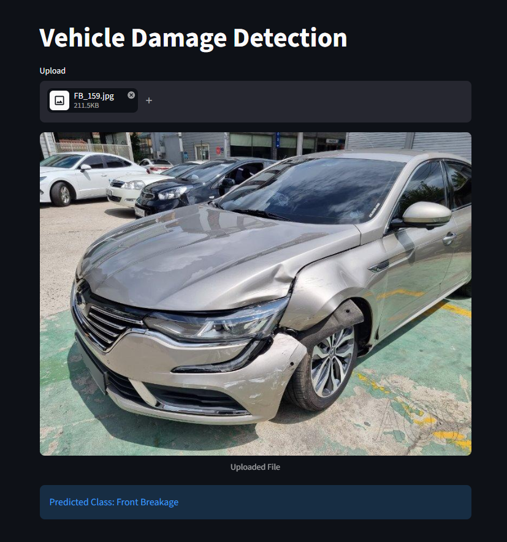

## Project Overview

Vehicle Damage Detection is a Deep Learning project that classifies vehicle images into six categories based on damage type and vehicle side.

The model is trained on front-view and rear-view vehicle images. Users can upload an image of either side through the Streamlit application to get a predicted damage category.

## Application Preview

The project includes a Streamlit web application where users can upload a vehicle image and get a predicted damage category.

## Vehicle Damage Categories

The model classifies vehicle images into the following six categories:

- Front Breakage
- Front Crushed
- Front Normal
- Rear Breakage
- Rear Crushed
- Rear Normal

## Models Experimented With

Four different deep learning models were implemented and evaluated:

1. Custom CNN
2. CNN with Regularization
3. EfficientNet-B0 (Transfer Learning)
4. ResNet50 (Transfer Learning)

## Final Model & Performance

ResNet50 was selected as the final model after experimentation and hyperparameter tuning, achieving a validation accuracy of **78.61%**.

## Tech Stack

- Python
- PyTorch
- Torchvision
- Streamlit
- ResNet50

## Author

**Muhammad Arif Bhatti**

- GitHub: [arifbhatti-py](https://github.com/arifbhatti-py)
- LinkedIn: [Muhammad Arif Bhatti](https://linkedin.com/in/arifbhatti)